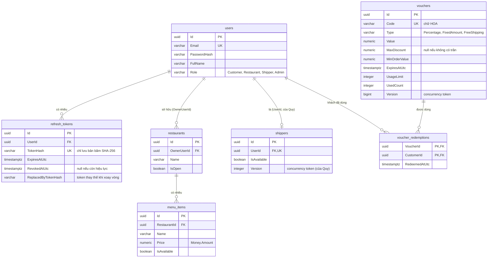

# Sơ đồ ER: phần của Vy (Xác thực, Quản lý quán, Voucher)

Tên cột khớp với mã nguồn (EF Core). Bảng `shippers` do Quy sở hữu (Vy chỉ tạo bản ghi lúc đăng ký);
bảng `orders` của Quy sẽ bổ sung sau. Hai bảng voucher được tạo ở tuần 9.

